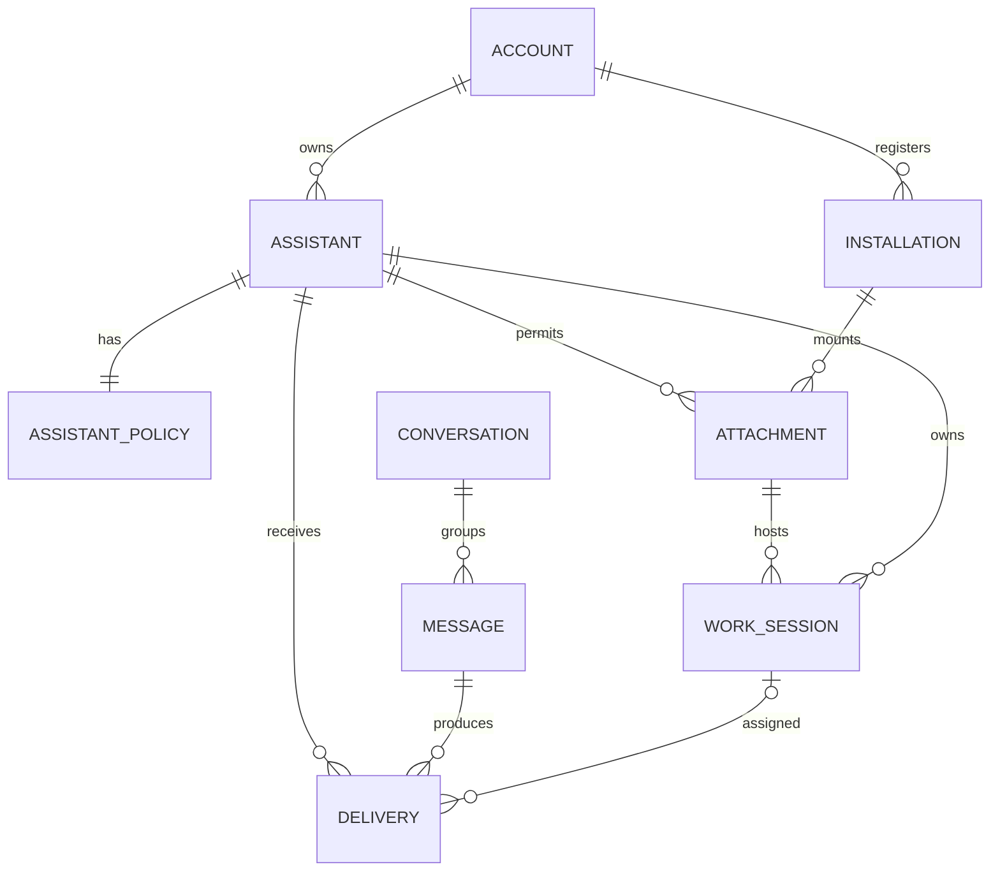

# Miles Works 领域模型 v2

日期：2026-10-31（Asia/Singapore）。状态：设计提案，未实施、未部署。

后续决定：用户接受 QUESTIONS.md Q1–Q5 的推荐默认。文中相关“待确认”保留为提案形成时的记录，现以该接受为准。用户另确认未迁移旧数据直接丢弃、不另备份，旧独立Worker/D1/R2/域名已退役，见 RETIREMENT.md。已删除的旧独立服务不再迁移；当前统一服务的新数据库仍须兼容演进，不能据此清空。v2 模型仍未上线。

UI后续收敛：会话注册和在线状态由MCP/bridge上报，管理平台保留查看、默认/展示设置、移除和恢复；模拟控件仅属于默认折叠的原型演示面板。客户端挂载位于助手详情，无独立“接入应用”导航；账户入口在右上角，登录独立页面。

## 1. 依据与边界

本轮实时查询远端 main：`95d5830253923bdac6afe8cb147ce1fc21f3dcc1`。本地 HEAD：`5cd69447a61f4ec002b1aab5df9d79c0c7089889`，为账户 UX 分支；不得把它当作已上线。现有设计复用 `designs/miles-works-review/system` 的视觉基础，但旧的 Space/连接权限/Consumer 交互不作为 v2 约束。本轮未查询生产数据库或读取凭据，线上运行版本不据 Git 推断。

用户已确认：

- 助手是唯一业务权限主体；权限以勾选表达，涵盖消息、密钥读取、修改、新建；不另建连接权限，不隔离每个 thread 的权限。
- 一个助手挂载多个客户端、拥有多个工作会话；授权阶段不要求先配置助手，使用时创建/选择助手并挂载。
- 助手有稳定消息地址；可设默认工作会话，也可不设，未指定目标的消息此时积压。
- 删除默认会话时替换为其他工作会话，无候选则保持无默认。暂时离线不等于删除。
- 工作会话可以注册、对外展示；发件人可以指定会话，也可以只选助手。
- 当前任务为探索、完整方案、交互设计和独立审阅；不自动执行生产变更。

未确认的默认值集中放在 QUESTIONS.md；正文中的“建议”不是用户既定决定。

## 2. 概念及所有权

| 实体 | 定义与拥有的数据 | 明确不是 |
|---|---|---|
| Account 账户 | 人类所有者、登录身份、账户管理入口 | Agent 的业务执行身份 |
| Assistant 助手 | 稳定 ID、显示名、状态、业务权限、消息地址、收件箱、可空默认会话 | 模型、进程、人格或一次 OAuth 登录 |
| AssistantPolicy 助手权限 | 消息启用、密钥读/改/新建、密钥集合范围、版本 | 每个客户端重复维护的授权表 |
| Installation 客户端实例 | 持久安装 ID、宿主类型、用户可改的设备标签、能力声明、最后见到时间 | 硬件指纹，也不由 client_id 唯一确定 |
| Attachment 挂载 | 某实例可代表某助手执行，状态 active/revoked；保留批准与撤销审计 | 独立的一组业务权限 |
| CredentialFamily 凭据家族 | OAuth 刷新链、audience、过期、撤销；引用实例或挂载 | 消息地址；用户必须理解的产品实体 |
| WorkSession 工作会话 | 一个宿主对话的服务端注册记录；归属一个助手，运行在一个实例 | 独立权限主体；跨宿主可搬运的模型内存 |
| Conversation 消息对话 | 助手间某件事的往来、参与者、执行分配 | Codex thread 或 Claude session |
| Message 消息 | 不可变发送者/目标/内容引用/幂等键；目标含可空会话 | 一次通知 |
| Delivery 投递处理记录 | 每个收件助手的处理单元、实际分配会话、领取/执行/回执 | 全局已读布尔值 |
| Bridge 本地桥接进程 | 轮询、能力检测、路由唤醒、持久通知账本、恢复诊断 | 助手、Consumer、处理完成的证明 |
| Consumer 内部读取视图 | 兼容游标与历史回执；新业务默认助手级视图 | 设备、收件人、工作会话 |
| Space 历史命名空间 | 保留旧消息、ACL、主键和存储归属的边界 | 新用户必须先配置的工作概念 |

默认会话是 Assistant 到 WorkSession 的可空引用，同账户、同助手、挂载未撤销、未删除；数据库/API 必须同时验证。一个客户端可以挂载多个助手；一个会话同一时刻只归属一个助手。会话迁到其他助手按关闭旧注册、创建新注册处理，保留原历史。

## 3. 身份、地址与稳定性

- `assistant_id` 不随改名、换机、凭据刷新变化。保留旧 actor 映射，禁止按名字自动合并。
- 消息地址按稳定助手 ID 解析，可提供可改显示别名。会话子地址包含稳定 `session_id`；删除后留墓碑，不把旧地址复用给新会话。
- `installation_id` 首次注册生成并本地持久保存；显示机器名仅标签。丢失本地状态须重新注册或走明确恢复，不靠 hostname 猜原实例。
- OAuth `client_id` 标识协议客户端注册，不证明机器/产品品牌。通用远程 MCP 无安装 ID 时可先建“未识别运行环境”，凭据稳定范围只到该注册/家族；不得宣称机器级稳定识别已实现。
- 宿主会话原始 ID 在服务端以 `(installation_id, host_kind, external_session_id)` 去重。不得信任任意客户端提交其他实例/助手的 ID。对外目录不暴露本地路径、启动命令、原始宿主 ID。
- 上述唯一性只约束有效注册，墓碑不阻止重新注册，但新注册必须分配新 session_id/世代，旧地址不复用。
- 复制凭据可能复制访问身份；不引入不必要的硬件绑定，也不承诺识别凭据克隆。

## 4. 登录、挂载与唯一权限主体

### 4.1 两阶段接入

1. 人类账户登录用于确认所有者。宿主完成接入时只能进入 bootstrap 状态：查看自身接入状态、提交创建助手/挂载申请、查询本人申请结果；不能读取消息或密钥、列举敏感账户资源、修改安全设置。
2. 使用时创建助手或申请挂载已有助手。用户在自己的已认证页面确认助手权限/挂载，客户端申请不得自行批准。创建无权限草稿可自动化。
3. 批准后该实例成为助手的执行客户端。业务请求明确选择 `assistant_id`；只有挂载有效才可使用助手权限。一个挂载助手时可自动选择，多助手不能用可变的全局“当前助手”串扰并发请求。
4. 给已有助手添加客户端时只确认“该客户端将具有此助手的全部权限”，不再重复配置独立权限。调整助手权限会影响所有挂载客户端。

挂载申请必须不可变绑定 request_id、account、installation、发起 family、目标 assistant、预览 policy_revision 和过期时间。批准由账户会话+CSRF验证，创建挂载与消费一次性请求同事务；政策变化则重新展示摘要。请求链接本身不能授权，bootstrap 不得替其他实例申请。

通用 MCP 的 OAuth token 不应被假定可由任意工具调用替换。候选实现是固定同一资源 audience 的接入凭据，服务端在线查有效挂载和助手策略；协议 scope 是接入能力分类，不复制用户业务 ACL。宿主能否在原凭据下重发现工具/完成挂载必须用 Codex/Claude/Grok 隔离验证，不能凭设计假定。必要时业务方法保持稳定、未挂载时返回结构化 `ASSISTANT_REQUIRED` 和批准入口。

### 4.2 权限规则

- 所有消息与密钥业务 API/MCP 调用：账户有效、凭据有效、挂载有效、助手有效、助手策略允许，缺一即拒绝。
- 四个主要勾选项：收发消息、读取密钥、修改密钥、新建密钥。新建与修改不自动隐含读取；新建仅返回条目标识和元数据，不回显秘密。
- “修改”不自动包含“删除密钥”。第一版删除留在人类账户管理界面，后续需要时另定义。
- 密钥范围由助手策略统一持有，可以是全账户或指定集合；未来新建条目、生产条目是否包含属于待确认默认，不隐藏在按钮文案中。
- 挂载批准、助手权限提升、所有权/安全设置是人类控制面操作，不因为助手拥有“修改密钥”而获得。已挂载且具有消息能力的客户端可注册/更新/移除自身工作会话，设置默认和目录展示，作为工作配置操作审计；这不允许它批准新客户端、扩大权限或管理其他助手。
- 策略收紧、暂停助手、撤销挂载在下一次服务端授权检查生效；不等旧 access token 到期。已取出的秘密、已经发生的外部操作无法追回。执行完成记录可保留内部对账路径，但撤销后的客户端不得继续提交被信任的完成结果。
- 本轮不做 thread 权限隔离。显式会话目标是路由约定，不是同助手内部保密边界。所有挂载客户端都拥有该助手的业务能力，这一点在挂载确认中明示。
- 旧 `memory_publish/read` 包含独立共享资料及删除，不能隐含在“收发消息”。建议 v2 首版仅提供消息及其附件，独立资料保持旧兼容路径，后续增加助手的资料能力复选框；是否纳入本次改造列为范围问题。附件读写必须关联可访问消息，不能无限制复用旧 blob API。已签发下载链接的撤销语义另验收，不能笼统承诺立即失效。

## 5. 工作会话及能力

会话注册字段：助手、实例、显示名、宿主类型/原始 ID、接收能力、可发现性、注册时间、最后心跳、状态、路由版本。状态与能力分开：registered/paused/deleted；最近是否在线；pull/manual 或 wakeable；身份握手是否通过。

注册 ≠ 可唤醒。不能唤醒的 Grok/远程 MCP 会话仍可注册和主动查收；UI 明确“需主动查收”。没有可持久获得的宿主会话 ID 时只登记手动收件位置，不伪造已验证绑定。

建议对外可发现性仅限账户内可互发消息的助手；不是公开互联网目录。注册后是否默认展示待确认。知道会话地址仍须通过账户/助手接收资格检查。

心跳超时标记离线，不删除、不重新分配。恢复后对原注册 ID 校验宿主身份。重命名不改地址。删除为软删除，保存历史和墓碑。

UI 操作称“移除工作会话”，只移除 Miles Works 注册和接收，不删除宿主 Codex/Claude 对话。宿主侧删除仅在适配器能可靠检测时同步失效；否则显示目标不可用，不能假定实时获知。

挂载撤销/实例禁用：使其会话不可接收，原子更新路由版本并按默认删除的替补规则处理，已领取/unknown 进入待核查，不自动重跑。会话主动暂停：保留默认选择但有效路由显示暂停，新消息等待；不冒充临时掉线或强制换默认。暂停会话不作为新替补候选。

## 6. 路由与投递

发送 API 支持 `recipient={assistant_id, session_id?}`。服务端保存不可变 `requested_session_id` 与 `target_mode=assistant|session`，另保存可变 `assigned_session_id`。原始意图不能被默认路由覆盖。

| 输入/事件 | 结果 |
|---|---|
| 新对话助手目标 + 有默认会话 | 分配到默认会话；离线则等待；旧对话按下节连续性规则 |
| 助手目标 + 无既有有效对话负责人 + 无默认 | `waiting_for_session`，保存在助手收件箱 |
| 指定有效会话 | 分配指定会话，不走默认 |
| 指定已删除/不属于该助手的会话 | 新发送拒绝，给明确错误；不默默降级为助手目标 |
| 已接受的指定会话消息，其目标随后删除 | `needs_handoff`，保留原目标与内容，用户显式转交 |
| 默认会话删除 | 同一事务软删除、更新默认/路由版本；候选不含暂停、已删、挂载撤销的会话 |
| 没有替代候选 | 默认置空，后续未指定消息等待 |
| 会话暂离线 | 不改默认；可人工切换，呈现待处理数量 |
| 默认会话变化 | 只影响未分配的新消息；旧分配按下面恢复规则处理 |

替代候选建议：同助手的其他有效注册会话，优先可唤醒且近期在线者，其后主动查收者；同级按注册时间与 ID 确定性选择。删除前显示将替换为谁；外部删除无法预览时留下审计和账户通知。是否允许跨客户端自动替换由 QUESTIONS.md 确认。

未分配积压在首次设置默认后可自动分配，但已指定目标、已领取、执行结果未知的记录不得混入自动回填。删除会话后其旧未完成记录统一进入交接检查，不将“没有 processed 回执”当作未执行。

### 6.1 对话连续性与显式目标优先

消息对话和工作会话分离。建议无显式 session 的同一对话沿用有效的负责人；新对话使用默认。原负责人失效时已开始的对话进入待交接，不自动用默认重启。显式指定 session 表达该消息的目标，不悄悄改变整段对话负责人。跨会话转交整段对话是单独操作，包含未完成状态和交接摘要。该连续性规则为提案，用户尚未细化确认。

为防两个不同消息在两个会话同时处理同一对话，新增 `(conversation_id, recipient_assistant_id)` 负责人/执行 generation 的 CAS 记录。显式改投其他会话时若原执行未完成，接受并保留目标，但进入待交接，不立即通知第二会话执行；没有活动执行时只分配本条并记录临时执行占用，不改长期负责人。领取同时校验此对话执行 generation；处理完成释放占用。消息级 claim 本身不足以保证对话串行。长任务租约过期不自动证明原执行停止，继续走待核查。

### 6.2 状态与并发

投递：stored → waiting_for_session / assigned → claimed → completed / failed / needs_handoff。通知记录单独维护 pending/notified/unknown/failed；读取证据单独记录。`notified` 不是 `read`，`read` 不是 `completed`。

一个处理单元的唯一性以 `(assistant_id, delivery_id)` 为准，不含客户端、会话、Consumer。会话分配版本和 claim generation 同时校验；过期领取者、旧路由桥接、被删会话不能提交有效完成。发送重试按发件助手+幂等键去重，相同键不同载荷拒绝。

租约只能协调本服务，不能保证 shell/邮件/部署等外部副作用 exactly-once。超时/通知返回丢失/执行结果未知要暂停自动重试，并通过宿主查询或人类确认恢复。自动重试仅适用于确定未分派或已知幂等操作。

## 7. Bridge 的位置

建议一台安装环境运行一个 bridge，可调度多个助手的会话；每个助手仍有独立挂载与身份上下文，不用一个账号万能 token 处理所有业务。

这里“一个安装环境”指本机 OS 用户下的一份 bridge 配置，不等于 Codex 的客户端实例。bridge 自身的 `installation_id` 与 Codex/Claude 的 `installation_id` 分开；同机不自动建立信任。会话的 `execution_installation_id` 指执行客户端，另以 `wake_binding(bridge_installation_id, session_id, registration_revision)` 表示哪份 bridge 被配对来唤醒它。配对同时核实两边对同一助手的有效挂载及 receiver proof，不复制另一客户端的凭据。桥接出站查询依据 wake_binding，不能误用“分配到bridge自己的会话”。无需让用户再管理一个机器层的实体。

Bridge 出站轮询由 wake_binding 授权其唤醒的会话通知，依据会话注册表选择唤醒适配器。服务端不接受任意消息里的命令、路径或 webhook 作为执行目标；适配器目标必须来自已登记配置。

保留现有 OAuth PKCE、刷新锁、私有凭据保存、SQLite 账本及 unknown 恢复。新的调度键至少包含助手、投递、会话、路由 generation、通知 attempt；旧账本只读映射，不通过改 thread 字段硬复用。

流程：服务端分配 → bridge 拉取 → 验证本实例/助手/会话注册与 receiver 身份 → 写通知意图 → 唤醒 → 写通知结果 → 接收会话读取/领取 → 处理 → 完成回执。通知触发后断线只进入 unknown，不直接再次唤醒。

Bridge 身份握手必须绑定助手、实例、会话注册版本，不能继续要求 bridge 与所有工作会话共享同一个固定旧 Consumer。bridge 自身不创建第二套助手业务权限。若独立挂载到助手，其凭据同样拥有助手全部业务权限，不能因实现只调用消息接口就称为消息只读凭据。优先探索受信本地 broker，但不能直接复制宿主 token；宿主不支持共享时独立 OAuth 并在助手客户端列表如实展示。若以后要求 bridge 无权接触密钥，就需要重新讨论技术凭据隔离，这是当前模型明确接受的取舍，不偷偷增加隐藏的连接 ACL。

默认仍用拉取，离线自动恢复。推送/长轮询属于后续优化，不以增加 Cloudflare DO/Queues 作为 v2 前置条件。具体模块变化、轮询延迟与凭据取舍见 research/bridge-routing.md。

## 8. 数据保留与非目标

- 删除会话/解绑客户端不删除助手、收件箱、消息、密钥或旧执行记录。
- 删除助手第一版为归档并停止业务访问；永久删除是独立数据操作，本轮不执行。
- 不自动给 Agent 账户管理权限；不设计多人组织 RBAC；不做会话级秘密隔离；不引入自动多会话广播执行。
- 不推断会话“思考完成”即任务成功；完成由业务回执及可核验结果定义。
- 不将跨 Space 互发与跨账户互发混为一谈。账户内可达地址解析需逐步实现，旧 Space 仍保留存储与权限边界，不能只隐藏选择器。

## 9. 需要证明的不变量

1. 修改助手权限无需编辑每条挂载；所有有效客户端一致生效。
2. 无有效挂载的实例知道助手/会话 ID 也不能执行。
3. 指定会话不被默认会话变化改投；发件目标永远可追溯。
4. 无默认会话不丢消息；离线不删会话；删会话不删消息。
5. 同一个处理单元跨客户端/旧 Consumer 竞争时最多一个有效 claim generation。
6. 默认替换与会话删除原子可见，不存在新投递进入已删默认的窗口。
7. 旧 worker/旧 bridge 不理解新状态时不能越过新调度规则执行。
8. 通知、读取、领取、执行、回执各有独立证据，不以 UI 点击冒充实际验收。
